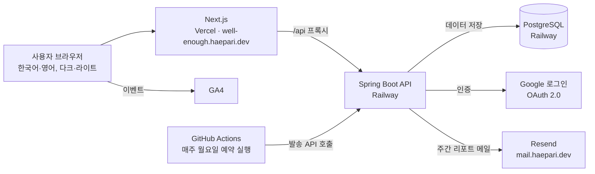

# Well Enough PRD v0.9

Nov 24, 2026 · @해리

## 개요

Well Enough(충분히 강녕한가요?)는 WHO 2020 신체활동 가이드라인으로 지난 7일 운동량을 진단하고, 부족분을 채우는 주간 플랜과 주간 리포트를 주는 웹서비스다.

- **문제**: 운동을 하긴 하는데 충분한지 판단할 기준이 없어 감으로 판단한다.
- **사용자 목표**: 기준 충족 여부와 부족분을 숫자로 확인하고, 다음 주 계획까지 받는다.
- **설계 원칙**: 입력 부담을 최소화하고, WCAG 2.2 AA 수준의 접근성을 지키며, 모든 판정에 근거 출처를 표시한다.

## 근거

판정 기준은 WHO 2020 가이드라인의 성인(18–64세) 권장량 하나만 쓴다. 출처: Bull 외, *British Journal of Sports Medicine* 54(24), 2020, pp.1451–1462 ([WHO 가이드라인 원문](https://www.ncbi.nlm.nih.gov/books/NBK566048/)).

| 항목 | WHO 권장량 (주당) | 이 서비스의 사용 방식 |
| --- | --- | --- |
| 유산소 | 중강도 150–300분, 또는 고강도 75–150분, 또는 둘의 조합 | 충족 판정의 기준 |
| 강도 환산 | 원문에 75분 ↔ 150분으로 제시 | 고강도 1분 = 중강도 2분으로 환산 (원문 비율에서 도출한 해석) |
| 근력운동 | 주요 근육군, 중강도 이상, 주 2일 이상 | 유산소와 별도로 판정 |
| 좌식 시간 | 줄이도록 권장 | 참고로만 표시, 판정에는 쓰지 않음 |

- 18세 미만, 65세 이상, 임신·산후, 만성질환자는 WHO 권장이 다르거나 추가 권장이 있다. MVP는 18–64세만 대상으로 하고, 결과 화면에 "의료 조언이 아님" 문구를 둔다.

## 설문 문항

설문은 IPAQ 단축형 한국어판(자기기입식) 7문항을 원문 그대로 쓰고, WHO 근력운동 판정용 1문항을 추가한다. IPAQ는 CC BY 4.0 라이선스로, 출처를 표기하면 허가 없이 사용·수정할 수 있다([IPAQ FAQ](https://sites.google.com/view/ipaq/faq)).

| # | 문항 (한국어판 원문) | 응답 | 다음 문항 | WHO 판정 |
| --- | --- | --- | --- | --- |
| 1 | 지난 7일간 무거운 물건 나르기, 달리기, 에어로빅, 빠른 속도로 자전거 타기 등과 같은 격렬한 신체 활동을 며칠간 하였습니까? | 0–7일 | 0일이면 3번 | 사용 |
| 2 | 그런 날 중 하루에 격렬한 신체활동을 하면서 보낸 시간이 보통 얼마나 됩니까? | 시간·분, 모르겠다 | 3번 | 사용 |
| 3 | 지난 7일간, 가벼운 물건 나르기, 보통 속도로 자전거 타기, 복식 테니스 등과 같은 중간정도 신체 활동을 며칠간 하였습니까? 걷기는 포함시키지 마십시오. | 0–7일 | 0일이면 5번 | 사용 |
| 4 | 그런 날 중 하루에 중간정도의 신체활동을 하며 보낸 시간이 보통 얼마나 됩니까? | 시간·분, 모르겠다 | 5번 | 사용 |
| 5 | 지난 7일간, 한번에 적어도 10분 이상 걸은 날이 며칠입니까? | 0–7일 | 0일이면 7번 | 참고 표시 |
| 6 | 그런 날 중 하루에 걸으면서 보낸 시간이 보통 얼마나 됩니까? | 시간·분, 모르겠다 | 7번 | 참고 표시 |
| 7 | 지난 7일간, 주중에 앉아서 보낸 시간이 보통 얼마나 됩니까? | 시간·분, 모르겠다 | 8번 | 참고 표시 |
| 8 | (자체 추가) 지난 7일간 웨이트, 맨몸운동, 밴드 운동처럼 주요 근육을 쓰는 근력운동을 며칠간 하였습니까? | 0–7일 | 결과 | 사용 |

**화면 적용 규칙**

- 문항 문구는 원문을 유지한다. 원문의 활동 정의는 해당 문항 위 보조 문구로 보여준다: 격렬한 활동 = "평소보다 숨이 훨씬 더 차게 만드는 활동", 중간정도 활동 = "평소보다 숨이 조금 더 차게 만드는 활동", 공통 = "한 번에 10분 이상 지속한 활동만".
- "모르겠다/확실하지 않다"를 고르면 대략이라도 입력하도록 한 번 안내하고, 그래도 모르면 해당 항목을 "판정 불가"로 표시한다.
- 설문명은 "국제 신체활동 설문(IPAQ)"으로 표기한다.
- 영어 화면은 IPAQ 영어 원문을 쓴다.
- 근거 안내 화면에 IPAQ 출처와 라이선스를 표기한다.

**계산 전 정리 규칙** ([IPAQ 데이터 처리 지침, 2005 개정](https://biobank.ctsu.ox.ac.uk/ukb/ukb/docs/ipaq_analysis.pdf))

- 하루 10분 미만 응답은 0으로 처리한다.
- 걷기·중간정도·격렬한 활동의 하루 시간이 180분을 넘으면 180분으로 자른다.
- 하루 기준 세 활동 합계가 960분(16시간)을 넘으면 입력값 확인을 요청한다.

## 타깃 사용자와 핵심 시나리오

주 타깃은 운동을 띄엄띄엄 하는 18–64세 성인이다. 운동 습관은 있지만 "이 정도면 충분한가"를 모르는 사람이다.

1. **첫 방문**: 공유 링크로 들어와 로그인 없이 1분 진단 → 결과에서 "기준까지 40분 부족"을 확인 → 다른 사용자 대비 위치(B)를 보고 궁금해진다.
2. **저장**: 결과를 저장하고 맞춤 주간 플랜(A)을 보려고 Google 로그인한다.
3. **재방문**: 매주 월요일 리포트 메일(C)을 받고 들어와, 지난번 답이 채워진 설문에서 바뀐 문항만 고쳐 최근 7일 기록을 갱신한다.

## 범위

1차는 웹으로 진단 + A·B·C + 소셜 로그인까지 배포하고 테스트한다. 그 다음이 Flutter 앱이다.

| 단계 | 포함 | 비고 |
| --- | --- | --- |
| 1차 (웹 MVP) | 진단, A 맞춤 주간 플랜, B 익명 비교 통계, C 주간 리포트(화면 + 이메일), Google 로그인, 한국어·영어, 다크·라이트 모드, GA4 | 진단은 로그인 없이 가능 |
| 2차 | Flutter 앱 (같은 Spring Boot API 사용), 이메일 로그인, 언어 추가 |  |
| 제외 | 웨어러블·건강 데이터 연동, 18–64세 외 연령 |  |

## 화면 정의

화면은 6개다. 설문은 한 화면에 한 문항씩 나눠 한 번에 판단할 양을 줄인다. 언어·테마 전환은 모든 화면 상단에 둔다. 로그인 사용자에게는 하단 탭(진단·플랜·마이)을 둔다.

| # | 화면 | 목적 | 주요 요소 | 로그인 |
| --- | --- | --- | --- | --- |
| 1 | 랜딩 | 진단 시작 유도 | 한 문장 설명, "약 1분" 소요 시간, 시작 버튼, 근거 안내 링크 | 불필요 |
| 2 | 설문 (단계형) | 8개 문항을 한 화면에 1개씩 | 진행 표시(예: 3/8), 일수는 0–7 버튼, 시간은 자주 쓰는 값 버튼 + 직접 입력, 0일이면 다음 활동 문항으로 자동 이동, 이전 문항으로 돌아가기, 입력값 임시 저장 | 불필요 |
| 3 | 결과 | 충족 여부와 부족분 확인 | 환산 시간 게이지(텍스트 병기), 판정(미달·충족·충분 이상별로 시각 강조, 색만으로 구분하지 않음), 부족분, B 비교 위치와 표본 수, 공유 버튼, 의료 조언 아님 문구 | 불필요 (저장 시 로그인) |
| 4 | 주간 플랜 | A 플랜 확인과 최근 7일 기록 갱신 | 요일별 플랜, 최근 7일 환산 시간 vs 목표(150분)와 마지막 갱신일, 기록 갱신 버튼 | 필요 |
| 5 | 마이 | 리포트와 히스토리 | C 지난주 리포트 카드, 주차별 추이, 이메일 리포트 수신 설정, 로그아웃, 계정 삭제 | 필요 |
| 6 | 근거·개인정보 안내 | 계산 방식과 데이터 처리 설명 | WHO·IPAQ 출처와 라이선스, 판정 공식, 수집 항목(익명 ID 포함), GA4 사용 고지, 계정 삭제 방법 | 불필요 |

### 기록 갱신 (재진단)

- 기록 갱신은 진단과 같은 8문항, 같은 기준(오늘부터 거꾸로 지난 7일)을 쓴다. 별도 입력 방식은 두지 않는다.
- 로그인 사용자가 기록을 갱신하면 지난번 답을 채운 8문항 요약 화면을 보여주고, 바뀐 문항만 눌러 고치게 한다. 첫 진단은 한 화면에 한 문항씩 진행한다.
- 요약 화면 상단에 "지난번 답이에요. 최근 7일과 다르면 고쳐 주세요"를 표시하고 지난 진단 날짜를 함께 보여준다.
- 갱신할 때마다 새 진단 1건으로 저장한다. 이전 진단은 덮어쓰지 않는다.

### 접근성 요구사항

- [WCAG 2.2](https://www.w3.org/TR/WCAG22/) AA를 기준으로 한다.
- 모든 기능은 키보드만으로 쓸 수 있고, 포커스 위치가 항상 보인다.
- 판정은 색만으로 전달하지 않고 텍스트와 아이콘을 함께 쓴다.
- 라이트·다크 모드 모두 AA 대비를 지킨다.
- 버튼은 손가락으로 누르기 충분한 크기로 만든다.
- 운영체제의 "동작 줄이기" 설정을 따른다.
- 결과 게이지 등 그래픽에는 스크린리더용 텍스트를 붙인다.

## 기능 명세

모든 판정·플랜 계산은 규칙 기반이다.

### 진단

- 입력: 설문 문항 1–8, 계산 전 정리 규칙 적용 후
- 고강도 분 = 격렬한 활동 일수 × 하루 시간, 중강도 분 = 중간정도 활동 일수 × 하루 시간
- 환산 시간(분) = 중강도 분 + 고강도 분 × 2
- 판정: 150분 미만 = 미달 · 150–300분 = 충족 · 300분 초과 = 충분 이상 (WHO는 300분을 넘기면 추가 건강 이점이 있다고 봄. 경고가 아니라 긍정 표현으로 보여준다)
- 근력운동: 주 2일 이상이면 충족, 유산소와 별도 표시
- 걷기·앉아 있던 시간: 판정 없이 참고로 표시
- 계산 위치: 서버(Spring Boot). 프론트는 표시만 한다.

### A. 맞춤 주간 플랜

WHO는 주당 총량("주 전체에 걸쳐")과 근력운동 주 2일 이상만 정하고, 하루 배분 규칙은 정하지 않는다. 아래 배분 규칙은 이 서비스가 정한 규칙이다.

- **기간**: 내일부터 7일. 진단이 "최근 7일" 기준이므로 플랜도 7일 단위로 맞춘다.
- **의미**: 지금 하던 운동에 더할 양을 보여준다. 기준은 가장 최근 진단이다.
- **유산소 추가분**: D = 150 − 환산 시간, 5분 단위로 올림. D ≤ 0이면 추가분 없이 "지금 수준 유지"를 보여준다.
- **나눌 날 수**: D ≥ 30분이면 3일, 20–25분이면 2일, 10–15분이면 1일, 10분 미만이면 10분 1일.
- **하루 양**: D를 날 수로 5분 단위로 나누고, 남는 5분은 앞쪽 날에 더한다. 하루 최소 10분(설문이 10분 이상 지속한 활동만 세기 때문).
- **배치**: 7일 중 1·3·5번째 날 (2일이면 2·5번째, 1일이면 3번째).
- **근력운동**: 최근 7일 근력운동 일수가 2일 미만이면 모자란 만큼 추가한다. 유산소가 없는 날에 넣고 서로 붙이지 않는다 (1일이면 4번째, 2일이면 2·6번째 날).
- **강도**: 시간은 중간정도 강도 기준이다. 격렬한 활동은 절반 시간으로 대신할 수 있다고 안내한다.
- **예시**: 환산 110분, 근력 1일 → 유산소 15·15·10분(1·3·5번째 날), 근력 1일(4번째 날).

### B. 익명 비교 통계

- 최근 4주 안에 진단한 사용자 중 내 환산 시간의 위치(백분위)를 보여준다. 사용자당 최신 진단 1건만 집계한다.
- 로그인하지 않은 진단도 집계한다. 첫 진단 때 브라우저에 무작위 익명 ID를 저장하고, 익명 ID당 최신 진단 1건만 센다. 로그인하면 익명 ID를 계정에 연결해 같은 사람이 두 번 세어지지 않게 한다.
- 익명 ID는 근거·개인정보 안내 화면과 개인정보 처리방침에 수집 항목으로 표시한다.
- **남용 방지**: 진단 제출은 익명으로 유지하되 반복 제출로 통계가 오염되지 않게 두 가지를 둔다.
  - 요청 횟수 제한: 같은 익명 ID 또는 같은 IP에서 짧은 시간에 많은 진단을 보내면 거절한다. IP는 횟수 제한에만 쓰고 DB에 저장하지 않는다.
  - Cloudflare Turnstile: 진단 제출 시 사람 확인 토큰을 받고, 백엔드가 Cloudflare에 토큰을 검증한 뒤 저장한다. 무료 플랜, 확인 요청 수 제한 없음([Turnstile 플랜](https://developers.cloudflare.com/turnstile/plans/)).
- 표본 수와 상관없이 표시하되, "n명 기준"과 오차 범위를 함께 보여준다.
- 문구는 "이 서비스 사용자 기준"으로 명시한다.
- 개인을 식별할 수 있는 값은 집계 결과에 넣지 않는다.
- 오차 범위(95% 신뢰수준, 최대치): 100명 ±약 10%p, 400명 ±약 5%p, 1,000명 ±약 3%p.

### C. 주간 리포트

- **화면**: 로그인 사용자가 새 주(월요일 시작)에 처음 방문하면 지난주 요약 카드를 보여준다: 환산 시간, 판정, 플랜 달성률, 이번 주 플랜.
- **집계 기준**: 지난주(월–일)에 한 진단 중 마지막 1건을 쓴다. 그 진단의 값은 진단한 날 기준 지난 7일이다. 지난주에 진단이 없으면 카드에 "지난주 기록 없음"을 표시하고 기록 갱신을 안내한다.
- **플랜 달성률**: 지난주 마지막 진단의 환산 시간 ÷ 지난주 플랜의 목표 분 (최대 100%).
- **이메일**: 수신에 동의한 사용자에게 매주 월요일 같은 내용을 메일로 보낸다. 기본값은 수신 안 함.
- **발송 서비스**: Resend 무료 플랜(월 3,000통, 일 100통). 발신 주소는 haepari.dev의 서브도메인을 쓴다(예: `report@mail.haepari.dev`). DNS는 Cloudflare에서 관리하므로 Cloudflare에 Resend가 안내하는 MX·SPF·DKIM 레코드 3개를 추가해 도메인을 인증한다.
- **발송 트리거**: GitHub Actions 예약 워크플로(공개 레포 무료)가 매주 월요일 백엔드의 발송 API를 호출한다. 발송 API는 비밀 토큰으로 보호한다. Railway 서비스가 잠들어 있어도 이 요청으로 깨어난다.
- **한도 초과 시**: 일 100통을 넘는 분량은 다음 날 이어서 보낸다.
- **메일 내용**: 모든 메일에 수신 해지 링크와 UTM 파라미터를 넣는다.
- **주의**: 공개 레포에서 60일간 활동이 없으면 예약 워크플로가 자동으로 꺼진다([GitHub 문서](https://docs.github.com/en/actions/how-tos/manage-workflow-runs/disable-and-enable-workflows)).

### 로그인

- Google 로그인(OAuth 2.0). 비밀번호를 직접 보관하지 않는다.
- 로그인 상태 증표는 HttpOnly 쿠키에 둔다. Next.js가 `/api` 요청을 Railway 백엔드로 대신 전달해, 브라우저는 서비스 도메인 하나만 상대한다.
- 이메일 로그인은 2차.

### 도메인

- 웹: `well-enough.haepari.dev`
- 메일 발신: `mail.haepari.dev`
- DNS: Cloudflare

### 다국어

- 한국어·영어 2개. 화면 문구는 언어별 번역 파일로 분리해 언어를 추가할 수 있는 구조로 만든다.
- 첫 방문은 브라우저 언어를 따르고, 상단에서 직접 바꿀 수 있다. 선택은 기억한다.

### 다크·라이트 모드

- 첫 방문은 운영체제 설정을 따르고, 상단에서 직접 바꿀 수 있다. 선택은 기억한다.
- 색은 테마별 변수로 정의해 두 모드 모두 AA 대비를 지킨다.

## 기술 스택과 아키텍처

프론트는 Next.js + Vercel, 백엔드는 Spring Boot, 서버와 DB는 Railway에 둔다.

브라우저는 Vercel의 Next.js와만 통신하고, Next.js가 `/api` 요청을 Railway의 Spring Boot로 전달한다. DB와 외부 서비스는 Spring Boot만 접근한다.

| 영역 | 선택 | 역할 |
| --- | --- | --- |
| 레포 | GitHub 공개 레포 `well-enough` 1개 (모노레포) | `frontend/`, `backend/`, `design/`, `docs/` |
| 프론트 | Next.js (TypeScript) | 화면, `/api` 프록시 |
| 프론트 배포 | Vercel | Git push 시 자동 배포 |
| 백엔드 | Spring Boot | 판정·플랜·통계·리포트 API |
| 서버·DB | Railway Free 플랜 (서버 + PostgreSQL) | 월 $1 크레딧 |
| 이메일 | Resend 무료 플랜 | 주간 리포트 메일 |
| 예약 실행 | GitHub Actions 예약 워크플로 | 매주 발송 API 호출 |
| 분석 | Google Analytics 4 | 이벤트 측정 |
| 도메인 | haepari.dev (DNS: Cloudflare) | 웹·메일 주소 |
| 다국어 | 오픈소스 i18n 라이브러리 | 한국어·영어 |
| 테마 | 테마별 CSS 변수 + 운영체제 설정 감지 | 다크·라이트 모드 |
| 남용 방지 | 요청 횟수 제한 + Cloudflare Turnstile | 익명 진단 반복 제출 방지 |
| 로컬 개발 | Docker(PostgreSQL) + DBeaver, Flyway | 로컬 DB, DB 구조 변경 이력 관리 |
| 코드 리뷰 | CodeRabbit | PR 자동 리뷰 |

**Railway Free 플랜 제약** ([요금 문서](https://docs.railway.com/pricing/plans)): 월 $1 크레딧(이월 없음), 서비스당 RAM 0.5GB, RAM 요금 GB당 월 $10. 유휴 시 잠드는 Serverless 설정을 켜고, DB 연결 풀은 유휴 시 연결을 닫도록 설정한다([Serverless 문서](https://docs.railway.com/reference/app-sleeping)).

## 테스트·품질 전략

테스트가 "돌려서 맞는지" 확인하고, CodeRabbit이 "읽고 의견"을 준다. 둘은 역할이 다르다.

1. **백엔드 단위 테스트 (JUnit)**: 진단 판정의 경계값부터 쓴다. 예: 환산 149분 = 미달, 150분 = 충족, 300분 = 충족, 301분 = 충분 이상.
2. **프론트 단위 테스트 (Vitest)**: 입력 검증, 결과 표시 컴포넌트, 언어·테마 전환.
3. **화면 동작 테스트 (Playwright)**: 랜딩 → 설문 → 결과 흐름 1개부터. 키보드만으로 완료되는지도 확인한다.
4. **GitHub Actions**: PR을 올리면 위 테스트가 자동 실행된다. 실패하면 머지하지 않는다.
5. **CodeRabbit**: PR마다 AI 리뷰. 공개 레포라 무료.

## 성공 지표

유입 → 진단 완료 → 로그인 → 재방문 퍼널을 GA4로 측정한다. 목표 수치는 공개 후 첫 2주 데이터를 보고 정한다.

**GA4 연동**

- Next.js 공식 `@next/third-parties`의 `GoogleAnalytics` 컴포넌트를 루트 레이아웃에 넣고, 이벤트는 `sendGAEvent`로 보낸다([Next.js 문서](https://nextjs.org/docs/app/guides/third-party-libraries)).
- 페이지뷰는 GA4 향상된 측정(Enhanced Measurement)의 브라우저 기록 기반 페이지 변경 설정으로 자동 수집한다.
- 측정 ID는 Vercel 환경변수로 관리한다.
- 이벤트 파라미터에 이메일 등 개인을 식별할 수 있는 값은 넣지 않는다.
- 근거·개인정보 안내 화면에 GA4 사용을 고지한다.

| 이벤트 | 의미 | 연결 화면 |
| --- | --- | --- |
| diagnosis\_start | 진단 시작 | 1 랜딩 |
| survey\_step\_exit | 설문 중 이탈한 문항 (피로도 지표) | 2 설문 |
| diagnosis\_complete | 진단 완료 (완료율 = 완료 ÷ 시작) | 3 결과 |
| result\_share | 결과 공유 | 3 결과 |
| login\_success | 로그인 전환 | 3 → 4 |
| report\_view | 리포트 카드 확인 (재방문율) | 5 마이 |
| report\_optin | 이메일 리포트 수신 동의 | 5 마이 |
| 메일 유입 | UTM(`utm_source=weekly_report`)으로 들어온 방문 | 4 주간 플랜 |

## 마일스톤

날짜는 정하지 않고 순서만 정한다.

1. 기획: 이 PRD 확정, Linear 이슈로 분해
2. 디자인: Figma 와이어프레임 → 라이트·다크 디자인 토큰
3. 레포·CI 세팅: GitHub, Actions, CodeRabbit 연결 (이후 모든 작업은 PR로)
4. 진단 기능: Next.js 단계형 설문 + Spring Boot 판정 API + 테스트, 한국어·영어 문구
5. 배포 1차: Vercel + Railway(서버·DB) 연결, 운영 환경변수, 서브도메인 연결, 사용량 확인
6. GA4 연동
7. Google 로그인
8. A 주간 플랜 → B 익명 통계 → C 주간 리포트(화면 → Resend 도메인 인증 → 예약 발송)
9. 접근성 점검: 키보드·스크린리더·대비
10. 마케팅: 공유 카드, 공개
11. 2차: Flutter 앱

## 미결정 사항과 리스크

디자인 착수 전에 남은 결정은 1개다. 서비스명은 Well Enough(한국어: 충분히 강녕한가요?), 주소는 `well-enough.haepari.dev`로 확정했다.

- [ ] Railway 실제 사용량 확인 후 플랜 유지 여부

| 리스크 | 대응 |
| --- | --- |
| 결과를 의료 조언으로 오해 | 결과 화면에 근거 출처와 "의료 조언 아님" 문구 |
| 표본이 적을 때 비교 통계 착시 | 표본 수와 오차 범위를 함께 표시 |
| 익명 진단 반복 제출로 통계 오염 | 요청 횟수 제한 + Turnstile. 저장소를 지우고 손으로 다시 내는 경우까지 완벽히 막지는 못함 |
| Railway $1 크레딧 초과 | Serverless 설정, 사용량 확인 후 플랜 재검토 |
| Resend 일 100통 한도 | 초과분 다음 날 발송, 화면 리포트로 보완 |
| 예약 워크플로 자동 비활성 (60일 무활동) | 마지막 발송 시각을 기록하고, 8일 이상 끊기면 로그로 확인 |

## 출처

- [WHO Guidelines on Physical Activity and Sedentary Behaviour (NCBI Bookshelf)](https://www.ncbi.nlm.nih.gov/books/NBK566048/)
- [Bull 외, 2020, British Journal of Sports Medicine (UEA ePrints)](https://ueaeprints.uea.ac.uk/id/eprint/77844)
- [IPAQ 공식 사이트](https://sites.google.com/view/ipaq), [IPAQ FAQ](https://sites.google.com/view/ipaq/faq), [IPAQ 다운로드](https://sites.google.com/view/ipaq/download)
- [IPAQ 데이터 처리 지침 (2005 개정)](https://biobank.ctsu.ox.ac.uk/ukb/ukb/docs/ipaq_analysis.pdf)
- [Korean IPAQ 단축형 타당도 연구 (PMC)](https://pmc.ncbi.nlm.nih.gov/articles/PMC3391639)
- [Railway 요금 플랜](https://docs.railway.com/pricing/plans), [Railway Serverless](https://docs.railway.com/reference/app-sleeping)
- [Resend 도메인 추가](https://resend.com/docs/add-a-domain)
- [Cloudflare Turnstile 플랜](https://developers.cloudflare.com/turnstile/plans/)
- [Spring Boot 데이터베이스 초기화 (Flyway)](https://docs.spring.io/spring-boot/how-to/data-initialization.html)
- [GitHub Actions 요금](https://docs.github.com/en/actions/concepts/billing-and-usage), [워크플로 비활성화](https://docs.github.com/en/actions/how-tos/manage-workflow-runs/disable-and-enable-workflows)
- [Next.js 서드파티 라이브러리 (GA4)](https://nextjs.org/docs/app/guides/third-party-libraries)
- [WCAG 2.2](https://www.w3.org/TR/WCAG22/)
